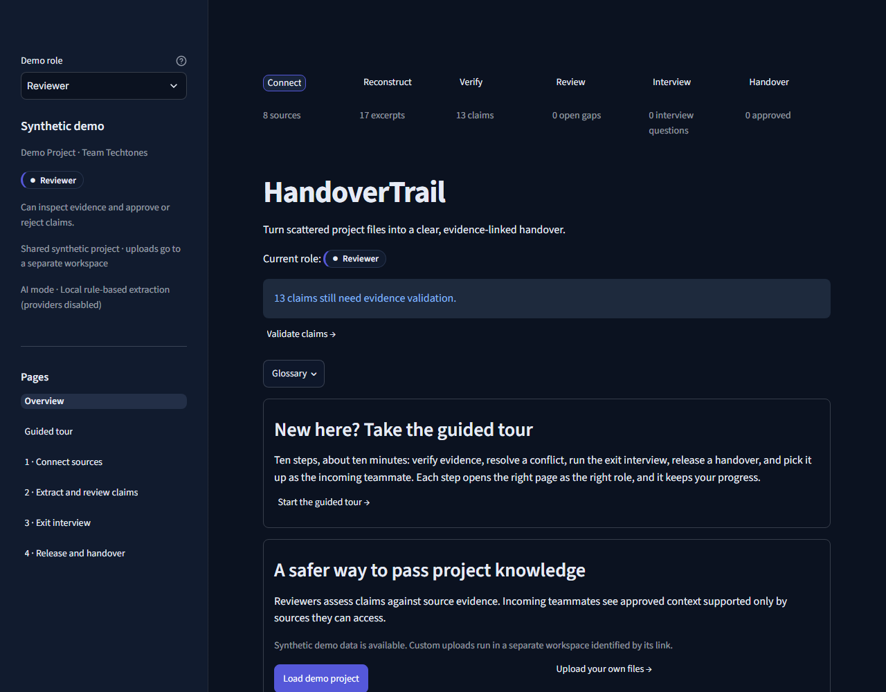
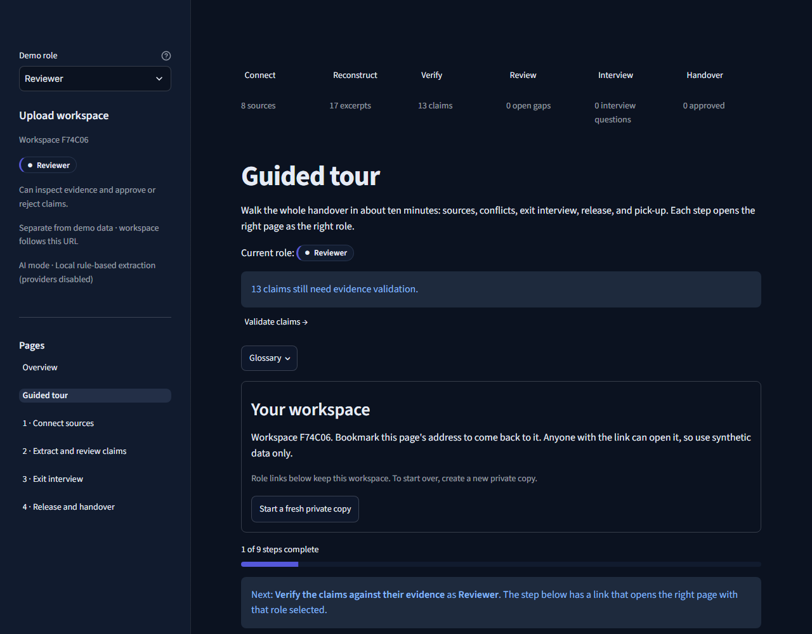
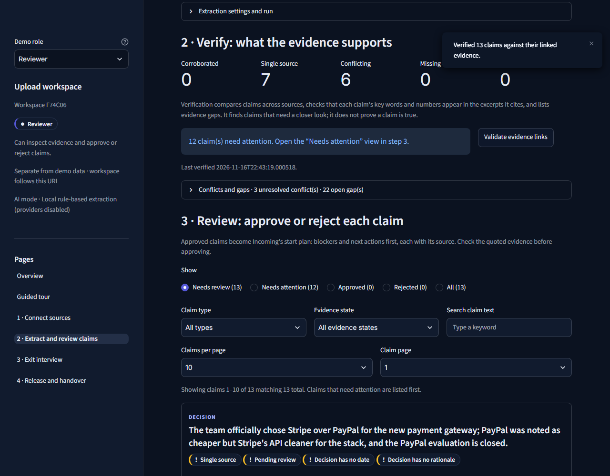
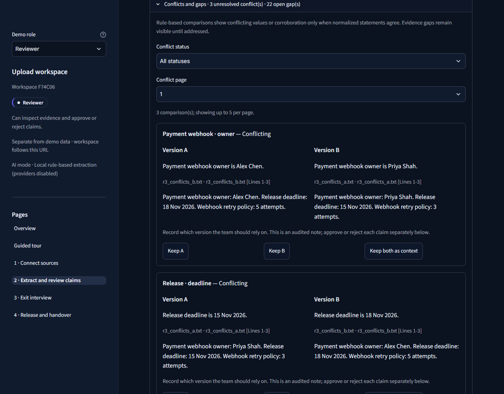
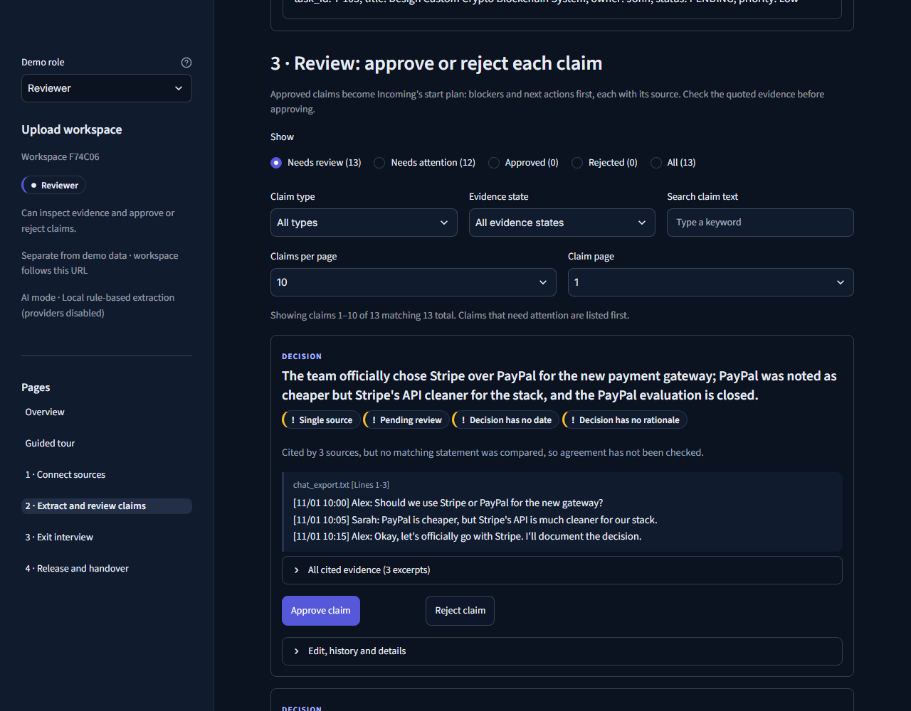
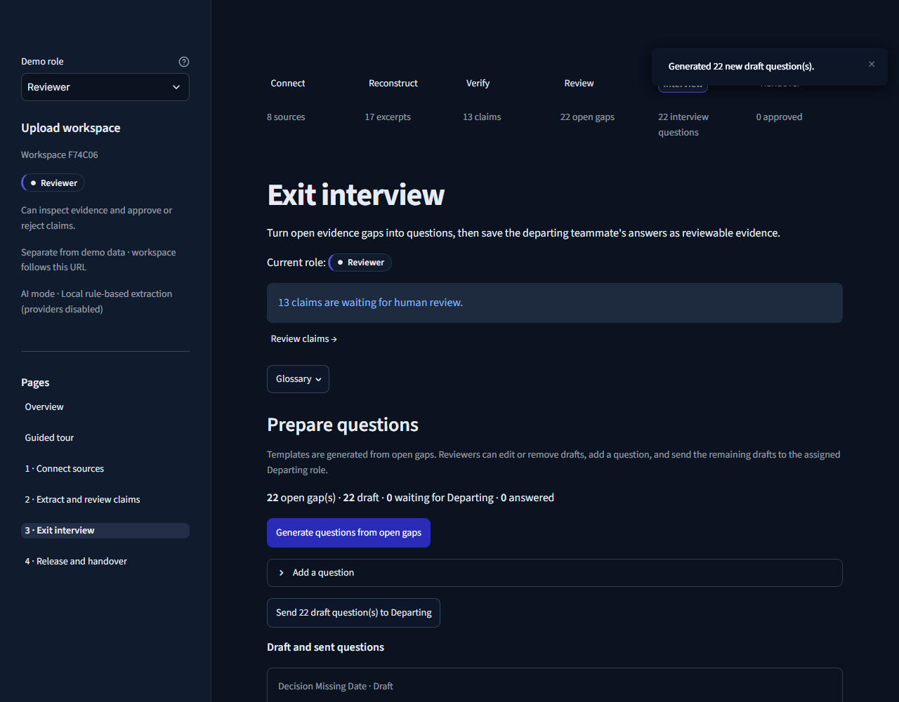
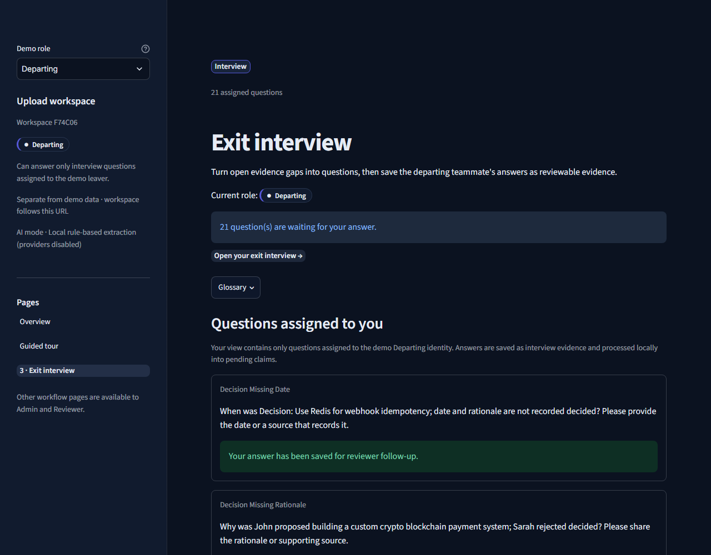
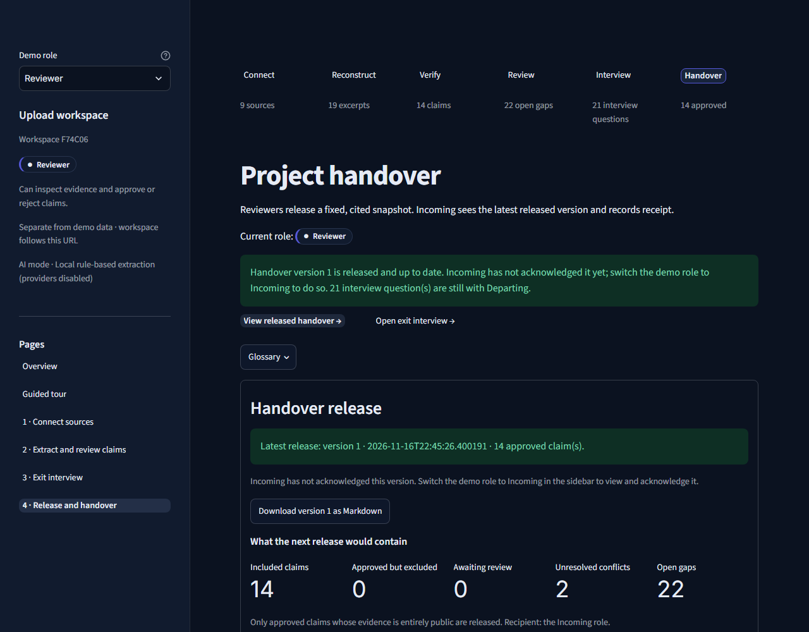
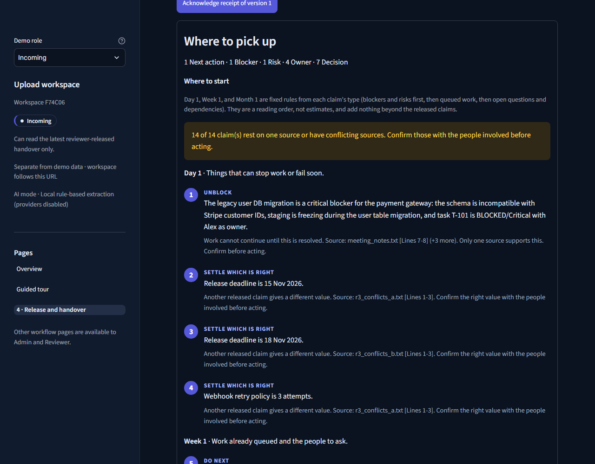
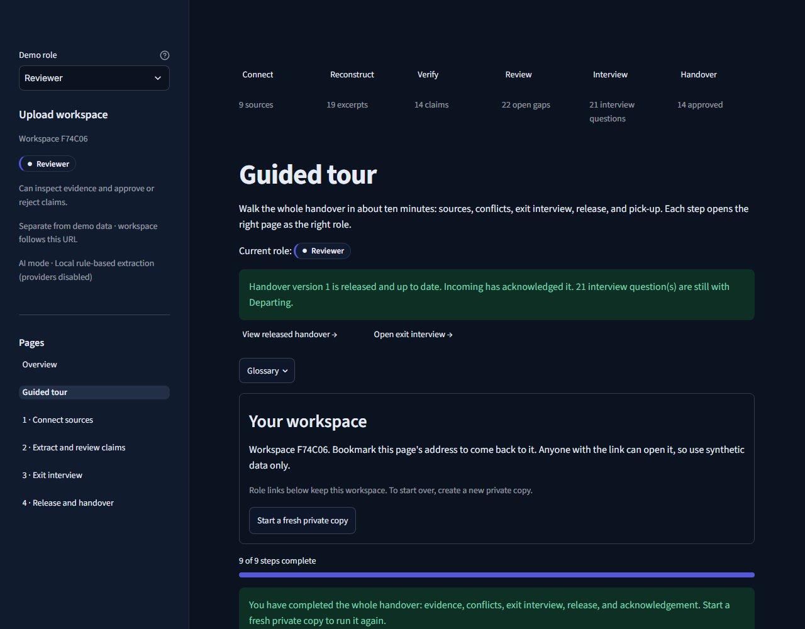

# HandoverTrail

**Hand over a project without losing what the leaver knew.** HandoverTrail reads
project notes, chat exports, repository summaries, and task lists, extracts
candidate claims with their source citations, finds where sources disagree or
information is missing, interviews the departing person about the gaps, and
releases a fixed, reviewer-approved handover that the incoming teammate can
pick up and acknowledge.

Built by **Aryan Khode** (team Techtones, solo) for the CodersInPune hackathon,
Round 3. Only synthetic data is used anywhere in the demo.

| | |
|---|---|
| **Live demo** | <https://handovertrail-aryankhode.streamlit.app/> (see [status of the live site](#status-of-the-live-site)) |
| **Repository** | <https://github.com/AryanK1547/HandoverTrail> |
| **Round 2 baseline** | git tag `round2-submitted` (commit `87b7c2b`) |
| **What changed since Round 2** | [ROUND3_COMPARISON.md](ROUND3_COMPARISON.md) |
| **Improvements delivered, with tests** | [ROUND3_DELIVERED.md](ROUND3_DELIVERED.md) |
| **Testing evidence** | [TESTING.md](TESTING.md) |
| **Known limitations** | [KNOWN_LIMITATIONS.md](KNOWN_LIMITATIONS.md) |

## Contents

1. [Try it in two minutes (for judges)](#try-it-in-two-minutes-for-judges)
2. [The three Round 3 improvements](#the-three-round-3-improvements)
3. [Walkthrough with screenshots](#walkthrough-with-screenshots)
4. [How it works](#how-it-works)
5. [Roles and what each can see](#roles-and-what-each-can-see)
6. [Trust and safety rules](#trust-and-safety-rules)
7. [Run it locally](#run-it-locally)
8. [Testing](#testing)
9. [AI provider configuration](#ai-provider-configuration)
10. [Repository map](#repository-map)
11. [Documentation index](#documentation-index)
12. [Status of the live site](#status-of-the-live-site)
13. [Limitations and roadmap](#limitations-and-roadmap)

---

## Try it in two minutes (for judges)

No account, no API key, and no data of your own are needed.

1. Open the app and choose **Start the guided tour** (first card on the
   landing page, or **Guided tour** in the sidebar).
2. Press **Start my private demo copy**. It creates a workspace with the same
   synthetic sources and claims as the shared demo, untouched and yours alone,
   so another visitor's approvals cannot change what you see.
3. Follow the numbered steps. Every step names the role to use and has a link
   that opens the right page with that role already selected:

| # | Step | Role | Proves |
|---|---|---|---|
| 1 | Connect the project sources | Reviewer | Sources parsed into cited excerpts, each Public or Restricted |
| 2 | Verify the claims against their evidence | Reviewer | Improvement 1 |
| 3 | Resolve a conflict | Reviewer | Improvement 1 |
| 4 | Approve claims after checking the evidence | Reviewer | Human review gate |
| 5 | Edit a claim and see its history (optional) | Reviewer | Improvement 3 |
| 6 | Turn gaps into interview questions | Reviewer | Improvement 2 |
| 7 | Answer as the departing teammate | Departing | Improvement 2 |
| 8 | Review the answer like any other claim | Reviewer | Improvement 2 |
| 9 | Release a fixed handover version | Reviewer | Improvement 3 |
| 10 | Pick up the work and acknowledge the version | Incoming | Improvement 3 |

Progress is read from the database, not from clicks, so the bar shows what has
actually happened in your workspace. The full path takes about ten minutes;
steps 2, 3, and 6 are the fastest way to see the first two improvements.

Prefer your own files? Choose **Upload your own files** on the landing page.
Uploads go to a separate workspace (`.txt`, `.md`, `.csv`, 2 MB per file) and
default to **Restricted**, so they never reach an AI provider unless you mark
them Public.

---

## The three Round 3 improvements

These are the three improvements promised at the end of Round 2. Each can be
shown in the live UI in under two minutes.

### 1. Conflict and missing-evidence detection

Claims are compared across sources by subject, attribute, and value (for
example *payment webhook · owner · Priya Shah*), after normalizing names and
dates. Matching values are **Corroborated**, different values are
**Conflicting** (or **Possible conflict** when the match is uncertain), and a
claim that rests on one source is flagged as such. Gap rules flag tasks without
an owner, decisions without a date or rationale, risks without a mitigation,
and single-source claims. The comparison is ordinary deterministic code, so it
is testable and makes no provider calls.

- **See it:** Review claims → *2 · Verify* and **Conflicts and gaps**
  (Version A beside Version B, each with its citation, and Keep A / Keep B /
  Keep both as context). Resolutions are written to an audit record.
- **Evidence check:** each claim also shows how many of its key words and
  numbers appear in the excerpts it cites, and lists what is missing.
- **Demo data:** three deliberate disagreements (owner, release date, retry
  policy) and several gaps in `data/demo_project/r3_*.txt`.

### 2. Gap-to-question exit interview

Open gaps become a short, editable list of questions for the departing person.
The reviewer can edit, delete, or add questions before sending them. The
**Departing** role sees only the questions assigned to them. An answer is saved
as a new `interview` source with author, timestamp, and a sensitivity choice,
then becomes a **pending** claim that goes through the normal review.

- **See it:** Exit interview as Reviewer (generate and send), then as Departing
  (answer), then back in Review claims (approve the new claim).
- **Closing the loop:** a gap moves from open to *answered, pending review* to
  *resolved* when the claim built from the answer is approved.

### 3. Provider-safe, accountable handover

- **Provider-safe extraction:** one gateway
  ([provider_gateway.py](provider_gateway.py)) builds every provider request.
  Only public-sensitivity excerpts may enter it, and a restricted excerpt that
  reaches it raises an error instead of being dropped quietly. Emails, phone
  numbers, credential-like tokens, and long ID numbers are masked first
  ([masking.py](masking.py)).
- **Claim editing with history:** every edit is stored as a new version with
  editor, time, and reason; old text is never overwritten. Editing an approved
  claim returns it to pending.
- **Release and acknowledgement:** a release is an immutable snapshot of the
  approved claims that cite only public evidence (database triggers reject
  updates and deletes). Incoming reads the latest release and acknowledges that
  exact version.

---

## Walkthrough with screenshots

All screenshots below were captured from the app running locally on a private
demo copy with AI providers disabled (synthetic data only).

### Start: landing page and guided tour



The landing page leads with the guided tour, then the six-step workflow.



The tour shows the next step, the role to use, what to do, and what you should
see. Each step has a link that opens the right page as the right role.

### Verify: what the evidence supports



The report counts corroborated, single-source, conflicting, and
missing-evidence claims and flags weak evidence matches. It finds claims that
need a closer look; it does not prove a claim is true.



Conflicting claims appear as Version A and Version B with their citations and a
recorded resolution.

### Review: approve or reject each claim



Each card leads with the claim, shows trust and review state plus a
plain-language reason, quotes the cited excerpt, and keeps edit, history, and
details one click away. Claims that need attention are listed first.

### Exit interview



Reviewers turn open gaps into drafts, edit them, and send them to Departing.



Departing sees only the questions assigned to them, not the sources or claims.

### Release and pick-up



The release panel shows the latest version, whether Incoming has acknowledged
it, and what the next release would contain: included claims, approved claims
excluded because they cite restricted sources, claims awaiting review,
unresolved conflicts, and open gaps. The reviewer confirms before a version is
created, and a new version is created only when something changed.



Incoming opens with **Where to pick up**: ordered first steps grouped into
Day 1, Week 1, and Month 1 from fixed rules on claim type (blockers and risks
first, then queued work and owners, then open questions and dependencies), each
step citing its source and noting when it needs confirming. It is a reading
order, not a schedule, and adds nothing beyond the released claims. The
released version also downloads as Markdown.



After the acknowledgement the tour shows all nine required steps complete.

---

## How it works

```text
 Sources (.txt .md .csv)            Public / Restricted per source
        │ parse
        ▼
 Evidence excerpts (file + lines)
        │ extract            ┌──────────────────────────────────────┐
        ▼                    │ provider_gateway: public excerpts    │
 Candidate claims  ◄─────────┤ only, masked first; restricted text  │
        │                    │ uses the local rule-based extractor  │
        │ validate           └──────────────────────────────────────┘
        ▼
 Conflicts and gaps (deterministic)  ──► Exit-interview questions
        │                                      │ answers become pending claims
        ▼                                      ▼
 Human review (approve / reject / edit, with history)
        │ release
        ▼
 Immutable handover version ──► Incoming reads it and acknowledges the version
```

| Layer | Technology |
|---|---|
| UI | Streamlit multipage app, role-aware navigation, dark theme with contrast-tested tokens |
| Storage | SQLite (additive, idempotent migrations) and local upload files |
| Extraction | Gemini `gemini-3.6-flash`, then OpenRouter `deepseek/deepseek-v4.1-flash-1017`, then a labeled local rule-based fallback |
| Conflict and gap detection | Local deterministic rules, no model calls |
| Tests | pytest (backend and UI helpers) and Playwright (real Chromium journeys) |

More detail, including the schema and permission model, is in
[ARCHITECTURE.md](ARCHITECTURE.md).

---

## Roles and what each can see

Roles are simulated by a selector; there is no login. Do not treat the selector
as a security boundary.

| Role | Can do | Cannot see |
|---|---|---|
| **Admin** | Everything Reviewer can | |
| **Reviewer** | Read public and restricted sources, extract, verify, edit, approve or reject, send interview questions, release | |
| **Departing** | Read and answer only the questions assigned to the leaver | Other sources, claims, and the handover |
| **Incoming** | Read the latest released snapshot and acknowledge its version | Restricted sources, unapproved or unreleased claims, upload and review controls |

Public interview answers stay hidden from Incoming until every claim linked to
that answer is approved and released.

---

## Trust and safety rules

- **Restricted text never goes to a provider.** Only public excerpts reach the
  gateway; a restricted excerpt reaching it raises an error. New uploads default
  to Restricted.
- **Masking before every provider call, and again for Incoming.** Emails, phone
  numbers, credential-like tokens, and long numeric IDs are replaced with
  placeholders. Pattern matching can miss unusual formats, so use synthetic data.
- **No claim reaches Incoming without a human approval.** Candidate claims,
  including those built from interview answers, wait in the review queue.
- **A released version cannot change.** Later edits appear only in a newer
  release, and acknowledgement is recorded against the exact version.
- **Corroborated means agreement was checked,** not that two filenames were
  linked as in Round 2.
- **Failures are visible.** Provider failure falls back to the labeled local
  extractor and says why; inputs over 80,000 characters are not sent to a
  provider.

---

## Run it locally

From the repository root in PowerShell:

```powershell
Set-Location '.\HandoverTrail'
python -m venv .venv
.\.venv\Scripts\python.exe -m pip install -r requirements.txt
.\.venv\Scripts\python.exe -m streamlit run app.py
```

An empty database is seeded automatically with the demo sources and cached demo
claims, so the whole flow works without an API key. The app stores data in
`handovertrail.db` beside `database.py` (override with `HANDOVERTRAIL_DB`) and
uploads under `uploads/<project_id>/` (override with `HANDOVERTRAIL_UPLOADS_DIR`).
These local files are not durable hosted storage.

If you change `ui.py` or another imported module while the app is running,
stop and restart Streamlit: it does not reload imported modules, and a stale
server can raise an `ImportError` for functions you just added.

## Testing

```powershell
.\.venv\Scripts\python.exe -m pip install -r requirements-dev.txt
.\.venv\Scripts\python.exe -m pytest -q tests

npm ci
npx playwright install chromium
npm run test:e2e
```

Last local run: **57 backend tests and 5 browser journeys passed**, with
provider calls disabled in all of them. The browser journeys drive a real
Chromium through: reviewer queue, release and acknowledgement, separate upload
workspaces, upload to acknowledged handover, and the guided tour. The runner
starts Streamlit on a free port with temporary data and removes it afterward;
no API keys are needed. Details, failure cases, and what is not covered are in
[TESTING.md](TESTING.md).

## AI provider configuration

Optional Streamlit secrets: `GEMINI_API_KEY` and `OPENROUTER_API_KEY`
(never commit them). Without them the app uses the local rule-based extractor,
which keeps explicit source statements and may miss indirectly worded claims.
AI extraction is limited to three runs per browser session. Providers are
named in [DISCLOSURES.md](DISCLOSURES.md), together with the AI tools used to
build the project.

---

## Repository map

| Path | Purpose |
|---|---|
| `app.py`, `pages/0_Guided_Tour.py` … `pages/4_Exit_Interview.py` | Landing page, guided tour, upload, review, handover, exit interview |
| `ui.py`, `ui_helpers.py` | Design system, workflow rail, role-aware navigation, next-step logic |
| `database.py`, `workspace.py` | Schema, seeding, project workspaces and private demo copies |
| `source_parser.py`, `extractor.py` | Parsing into excerpts; claim extraction |
| `provider_gateway.py`, `masking.py` | The only door to AI providers; masking patterns |
| `validator.py`, `conflict_detection.py`, `claim_insights.py` | Evidence checks, conflicts and gaps, evidence-match scoring |
| `claim_history.py` | Claim edits and version history |
| `interviews.py` | Questions from gaps, answers as evidence |
| `handover_release.py`, `handover_plan.py` | Release snapshots and acknowledgement; Day 1 / Week 1 / Month 1 plan |
| `judge_tour.py` | Guided-tour steps and completion from stored state |
| `permissions.py`, `retrieval.py` | Role checks; role-scoped, masked reads |
| `data/demo_project/`, `data/demo_cache/` | Synthetic sources and cached demo claims |
| `tests/` | pytest suite and Playwright journeys (`tests/e2e/`) |
| `docs/screenshots/` | Images used in this README |

## Documentation index

| Document | What it answers |
|---|---|
| [ROUND3_COMPARISON.md](ROUND3_COMPARISON.md) | Round 2 vs. the promise vs. the plan vs. what was built |
| [ROUND3_DELIVERED.md](ROUND3_DELIVERED.md) | Per improvement: delivered, where in the UI, which tests, what is not done |
| [CHANGES_FROM_PLAN.md](CHANGES_FROM_PLAN.md) | Deviations from the master plan and extra changes |
| [ROUND3_MASTER_PLAN.md](ROUND3_MASTER_PLAN.md) | The Round 3 plan |
| [ARCHITECTURE.md](ARCHITECTURE.md) | Data flow, schema, permission model, design decisions |
| [TESTING.md](TESTING.md) | Journeys, failure cases, permissions, reliability notes |
| [KNOWN_LIMITATIONS.md](KNOWN_LIMITATIONS.md) | What the app does not do |
| [DISCLOSURES.md](DISCLOSURES.md) | AI tools used to build it and models used inside it |
| [DEPLOYED_QA_REPORT.md](DEPLOYED_QA_REPORT.md) | Findings from checking the deployed site |
| [docs/ROUND3_LOG.md](docs/ROUND3_LOG.md) | Round 3 window and baseline tag |

---

## Status of the live site

- The live app is on Streamlit Community Cloud. On 16 Nov 2026 its footer
  reported commit `106d76e` (the merge of the final UX work into `main`), so it
  includes everything described in this README. A scripted Chromium run
  completed the whole guided journey on the live site using a private demo
  copy: validate evidence, resolve a conflict, approve claims, generate and send
  interview questions, answer as Departing, approve the answer-derived claim,
  release version 1, read the Day 1 / Week 1 plan as Incoming (the restricted
  file never appeared), and acknowledge. The tour then showed 9 of 9 steps
  complete. Incoming had no upload controls and Departing opening the handover
  page showed guidance, not an error. The upload page states the 2 MB limit
  consistently.
- Not exercised on the live site: AI extraction (the run deliberately did not
  click Extract, to spare the free-tier quota), uploading your own files,
  Firefox and WebKit, and restart behavior. The earlier 13 Nov findings in
  `DEPLOYED_QA_REPORT.md` describe commit `839953b`.
- Shortly after a merge, the app briefly showed an `ImportError` on its first
  load and then loaded normally on the next check. The cause was not confirmed
  (a redeploy in progress is the likely one); if you see it, reload after a
  minute.
- Streamlit sleeps apps without traffic; a first visit may show a wake-up
  screen. Hosted storage is not durable, so data and uploads reset when the
  instance restarts, and a redeploy resets the demo database.
- Anyone with a workspace link can open that workspace. Use synthetic data only.

## Limitations and roadmap

**Limitations (honest list)**

- No authentication: roles and workspaces are demo conveniences, not access
  control. Production use needs real identity and durable external storage.
- Extraction and conflict detection use explicit wording rules; indirectly
  phrased statements can be missed, and the evidence-match score is lexical (it
  cannot judge paraphrase or prove a claim true).
- Masking is pattern-based and conservative but not exhaustive.
- Interview questions come from local templates; optional model rewording was
  not built.
- Not built from the plan: the Git Handover analysis and a comprehension check
  before acknowledgement.
- Not verified: the hosted site's current build, live provider responses,
  Firefox and WebKit, keyboard-only and screen-reader use, and many
  simultaneous users.

**Roadmap**

1. Real authentication with per-person roles, and a durable database.
2. Optional cached model assistance for slot extraction and question wording,
   still routed through the provider gateway.
3. Git Handover: leaver footprint and knowledge-at-risk from commit history
   (design in [ROUND3_BONUS_GIT_HANDOVER.md](ROUND3_BONUS_GIT_HANDOVER.md)).
4. A comprehension check before acknowledgement, and a multi-file handover pack.

## License

MIT, see [LICENSE](../LICENSE).
